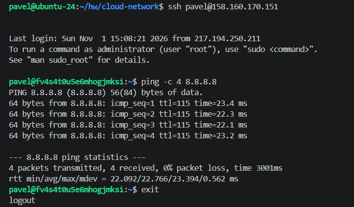
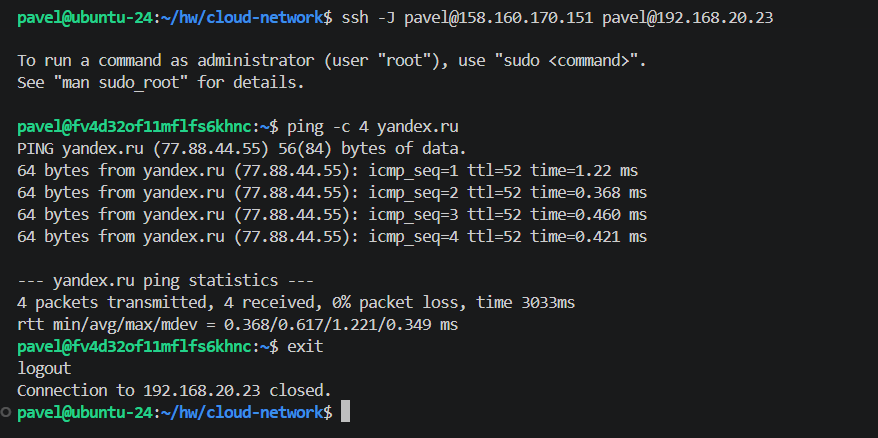

# Домашнее задание к занятию «Организация сети» — Рыбянцев Павел

Репозиторий содержит декларативный код Terraform для автоматизированного развёртывания сетевой инфраструктуры с публичным и приватным контурами в **Yandex Cloud**.

---

## Сетевая топология и структура проекта

### Описание архитектуры
* **VPC:** Создана изолированная виртуальная сеть `vpc-network`.
* **Public Subnet:** Сеть `192.168.10.0/24`. В ней развёрнут специализированный **NAT-инстанс** (`ip: 192.168.10.254`, образ `fd80mrhj8fl2oe87o4e1`) с публичным IP, а также тестовая виртуальная машина `public-vm`.
* **Private Subnet:** Сеть `192.168.20.0/24`. Виртуальные машины в ней не имеют внешних IP-адресов для обеспечения безопасности закрытого контура.
* **Маршрутизация:** Создана таблица маршрутов `private-route-table`, которая перенаправляет весь исходящий трафик (`0.0.0.0/0`) из приватной подсети на внутренний IP-адрес NAT-инстанса.

### Структура каталогов (Tree View)
```text
├── main.tf                     # NAT-инстанс, public_vm, private_vm
├── network.tf                  # VPC, подсети, таблица маршрутизации
├── outputs.tf                  # Динамический вывод IP
├── providers.tf                # Конфигурация провайдера Yandex Cloud (авторизация через SA)
└── variables.tf                # Входные переменные (cloud_id, folder_id, ресурсы ВМ)
```

---

## Инструкция по развертыванию и проверке

1. **Инициализация проекта:**
   ```bash
   terraform init
   ```
2. **Проверка конфигурации и создание плана:**
   ```bash
   terraform plan
   ```
3. **Применение конфигурации:**
   ```bash
   terraform apply -auto-approve
   ```

После успешного выполнения команды `terraform apply` в терминал автоматически выведется готовый блок `homework_report`. Он содержит динамически подставленные IP-адреса и готовые команды для проверки связности.

---

## Результаты проверки работоспособности

1. **Подключение к public-vm и проверка прямого доступа в интернет:**



2. **Подключение к private-vm через бастион (public-vm) и проверка выхода в интернет через NAT-инстанс:**


